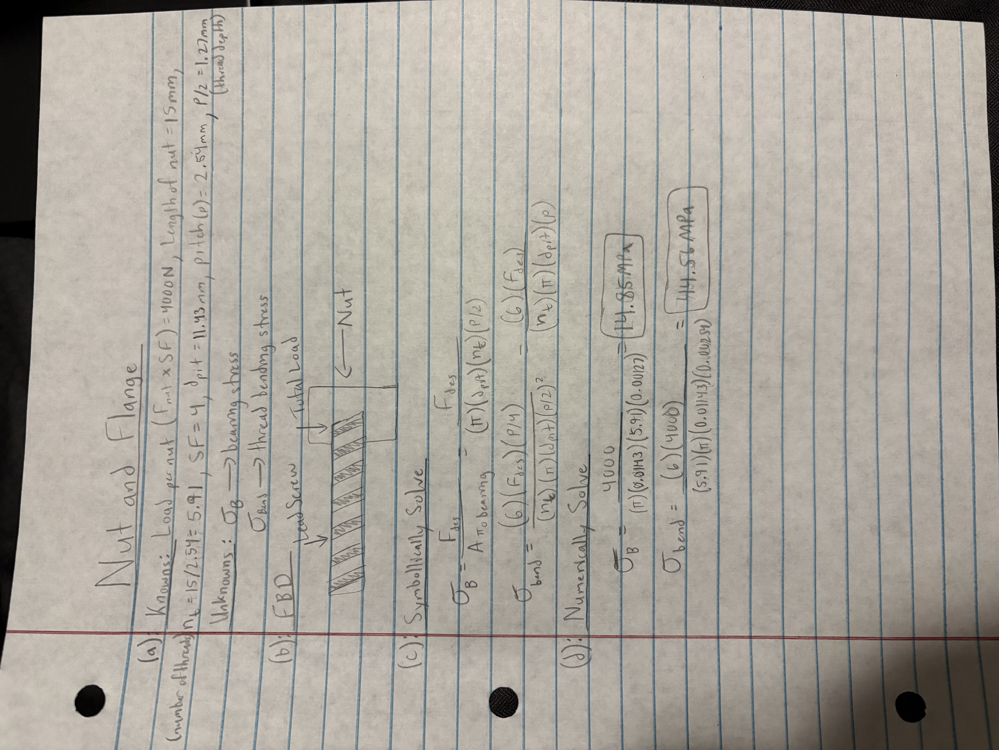

# A10 – Lead Screw Design Part 1

## Objective

## Nut and Flange Calculations - Drew Wayne
For the nut flange, I first listed the knowns and unknowns. I then drew an FBD to show how the load acts on the nut and screw. After that, I used the equations for bearing stress and thread bending stress and plugged in my values to calculate 14.85 MPa for the bearing stress and 44.56 MPa for the thread bending stress. I ended up choosing a bronze acme flange nut with a thread size of 1/2" - 10 so that it works with our lead screw we chose previously.

## Crosshead Design

 here. How does this design follow from that decision?_

## Communicate

