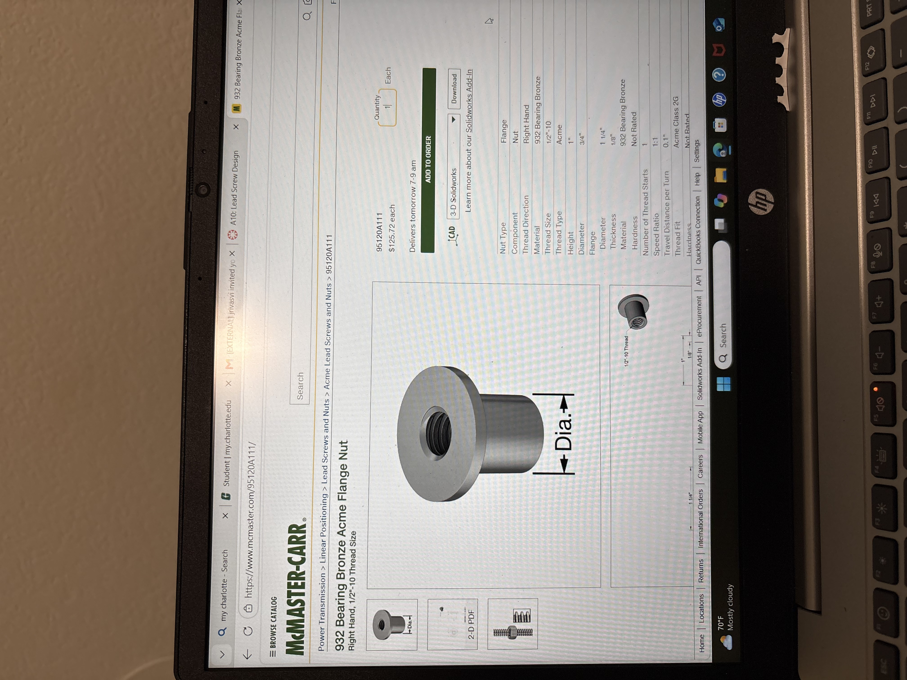
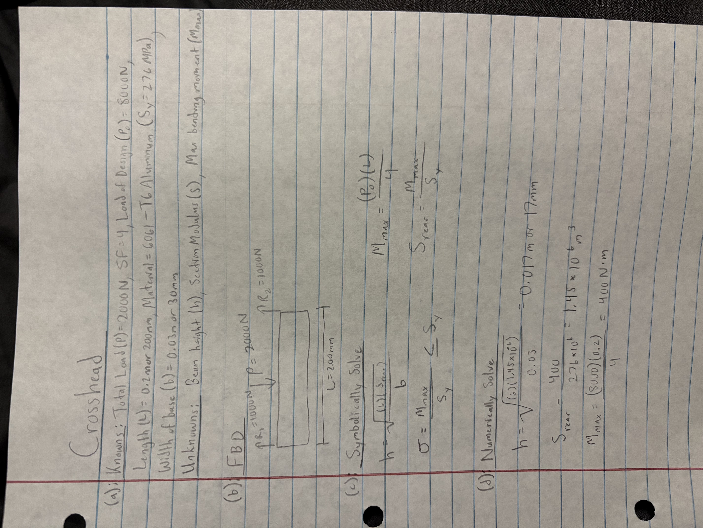
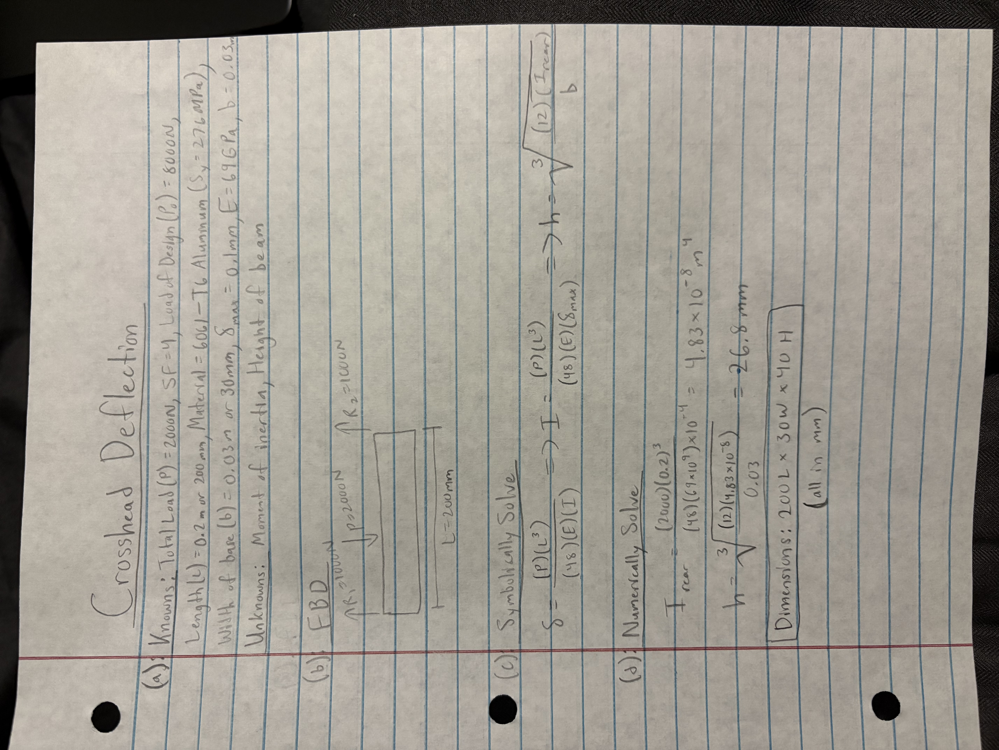
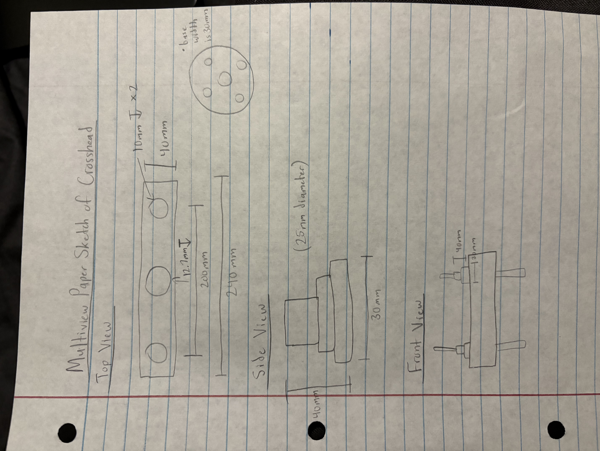

# A10 – Lead Screw Design Part 1

## Objective- Joel Rivas
This week were tasked with the initial setup for a 2 part project. We had to choose a lead screw using the diameter, rotational speed, and max torque. We also had to choose a nut and flange making sure they supported the load. Lastly, we had to design a crosshead with a max deflection of .1mm. The key constraints for this week were: no electronics, load capacity of 2kN split between the two lead screws, linear speed range of 1-50 mm/min, and a safety factor of 4. 

## Leadscrew Diameter- Joel Rivas
This first step was to calculate the minimum leadscrew diameter. I chose a low carbon steel because it is definitely strong enough, inexpensive, and works well with the bronze nut. McMaster didn't have the exact yield strength so I used the lower bound I found from an online steel properties table( https://us.misumi-ec.com/blog/yield-strength-stress-chart/ ), and this gave me a yield strength of 210 MPa. Using this value I was able to calculate the minimum diameter to be 4.92 mm or 0.194 in. The standard 1/2 in -10 ACME screw has a minor diameter of 10.2 mm which is more than enough according to my hand calculations, but McMaster didn't have an 8mm screw so the safest choice was to settle on the 1/2 in diameter screw. The length of 3 ft is greater than the minimum 18 in required while also making sure to leave space for the nut, thrust bearing, and crosshead. 

## Leadscrew Rotational Speed- Joel Rivas
The second step was to calculate the range of rotational speed the lead screw could handle. The knowns for this part were the linear speed range of 1-50 mm/min, pitch of 0.1 in = 2.54 mm, and lead of 0.1in/rev= 2.54 mm/rev. The pitch and lead are the same in this example. The driving formula for this step was V=N*L which I rearranged to be N=V/L in order to be able to get the rotational speed from the lower and upper end of the linear speed range. The final range of rotational speed came out to be 0.39- 19.7 RPM. The bottom range is really slow and would require a gear reduction if it was ran. 

## Leadscrew Torque- Joel Rivas
The final calculation for the leadscrew was the max torque to provide the 2kN tension. The knowns for this part were: load per screw (P)=1000 N, Diameter(d)= 12.7 mm, Pitch(p)/Lead(L)= 2.54mm, Pitch diameter (d_m)= 11.43mm, Friction Coefficient(mu)= 0.15, C= 39.898 mm(using pitch diameter). We had to find the effort force in order to find the max torque per screw. We used the power screw formulas we derived in class which were F=P*((mu*C+L)/(C-mu*L)) and T=F*r. In this part the radius we used was half of the pitch diameter. The first free body diagram is the unwrapped thread as an inclined plane, and the second is the more real world depiction showing the load acting down the screw and the torque being applied at the top. The torque came out to 1.23 N*m. There is also another formula in the handbook which says T_d=(P*L)/(2pi*e) where e is the ball screw efficiency. Plugging in our values gets a max torque of 1.01 N*m which isn't too far from the calculated value we had previously, but it also uses a lower friction coefficient which explains why the value is lower. This value helped confirm that the torque calculation was done correctly.  

## Leadscrew Selection- Joel Rivas
The leadscrew we selected is a 1/2 in-10 ACME low carbon steel screw, 3 ft long (McMaster 98935A823). Its minor diameter of ~10mm is around double the minimum diameter of 4.92 mm to carry 1kN per screw with a safety factor of 4. The thread is self-locking, so that will aid holding the crosshead in position while under load. 

## Nut and Flange Calculations - Drew Wayne
For the nut flange, I first listed the knowns and unknowns. I then drew an FBD to show how the load acts on the nut and screw. After that, I used the equations for bearing stress and thread bending stress and plugged in my values to calculate 14.85 MPa for the bearing stress and 44.56 MPa for the thread bending stress. I ended up choosing a bronze acme flange nut with a thread size of 1/2" - 10 so that it works with our lead screw we chose previously.

## Crosshead Design - Drew Wayne
For the crosshead design, I first listed my knowns and unknowns. The material that I ended up choosing was 6061-T6 aluminum. I then drew a FBD to show the applied load and reaction forces on both ends. I then used the bending moment and section modulus equations to determine the required dimensions. Using my calculated values, I found a maximum bending moment of 400 N * m and a required section modulus of 1.45 x 10^-6 m^3 and a beam height of approximately 17mm. 

For the crosshead deflection, I used the same load, material, and dimensions from my previous calculations to make sure the beam would not deflect more than 0.1mm. I first drew a FBD showing the applied load and reaction forces. I then used the deflection equation to solve for the required moment of inertia, which came out to be 4,83 x 10^-8 m^4. From there, I calculated a minimum beam height of 26.8mm and decided to use final dimensions of 200mm long, 30mm wide, and 40mm high to keep the deflection within the required limit.

For this part, I created a multi-view paper sketch of my crosshead to show how the design would look from the top, side, and front views. I included the main dimensions, such as the overall length of 240mm, the spacing between the holes of 200mm, and the different hole diameters. I also sketched the side and front views to show the height, width, and placement of the different features. This helped me get a better idea of how we need our crosshead to look before modeling it in SolidWorks.

## Decide

## Material Cost Table - Mike Sweeney
The following table lists the selected components for the lead screw tensile tester, including quantities, unit prices, and total costs. Prices were obtained from McMaster-Carr. The crosshead was designed separately in SolidWorks and is not included in the material costs.

| Item Number | Quantity | Name | Cost/Item | Total Cost | Purchase Link |
|---|---:|---|---:|---:|---|
| 1 | 2 | Bronze Acme Flange Nut | $125.72 | $251.44 | [95120A111](https://www.mcmaster.com/95120A111/) |
| 2 | 2 | Needle-Roller Thrust Bearing | $4.46 | $8.92 | [5909K31](https://www.mcmaster.com/5909K31/) |
| 3 | 4 | Thrust Bearing Washer | $1.40 | $5.60 | [5909K44](https://www.mcmaster.com/5909K44/) |
| 4 | 2 | Linear Bearing Housing | $32.66 | $65.32 | [9804K1](https://www.mcmaster.com/9804K1/) |
| 5 | 2 | 36-inch Acme Lead Screw | $9.90 | $19.80 | [98935A823](https://www.mcmaster.com/98935A823/) |
| 6 | 2 | 54-inch T-Slot Frame Rail | $115.56 | $231.12 | [5537T914](https://www.mcmaster.com/5537T914/) |
| 7 | 2 | 16-inch T-Slot Frame Rail | $40.32 | $80.64 | [5537T914](https://www.mcmaster.com/5537T914/) |
| | | **Total Material Cost** | | **$662.84** | |

## Parametric Modeling - Mike Sweeney
For the parametric modeling portion, I used SolidWorks to create the crosshead and assemble the two lead screws and bronze flange nuts. I also assembled the aluminum T-slot frame using downloaded CAD components from McMaster-Carr. The lead screw mechanism and frame were modeled separately.

### Crosshead and Lead Screw Assembly
I created the crosshead in SolidWorks and added two holes spaced 200 mm apart for the lead screws. I then imported the downloaded lead screws and bronze flange nuts and used concentric and screw mates to align the components.

### Frame Assembly
I assembled the frame using four 80 × 40 mm T-slot aluminum extrusions from McMaster-Carr. Two 54-inch rails were used for the vertical supports, and two 16-inch rails were used for the horizontal supports. I used assembly mates to position the rails and create the rectangular frame.

### CAD File Downloads
The SolidWorks part and assembly files are available below.

## Finite Element Analysis (FEA) - Mike Sweeney

### FEA Model Setup
I used SolidWorks Simulation to perform a static analysis of the crosshead under a 2,000 N load. The material was 6061 Aluminum Alloy. I applied Fixed Geometry to the inside surfaces of both lead screw holes and applied the downward force to a 20 × 20 mm region at the center of the crosshead. This simplified the actual nut and flange connections while allowing me to evaluate the stress and deflection of the crosshead.

### Mesh Convergence
Mesh Convergence
I ran three simulations with progressively finer meshes while keeping the material, geometry, fixtures, and applied load the same.

| Measurement | Run 1 | Run 2 | Run 3 |
|---|---:|---:|---:|
| Max Mesh Size (mm) | 8.014 | 6.233 | 3.562 |
| Total Elements | 6,789 | 15,645 | 61,926 |
| Max von Mises Stress (MPa) | 7.365 | 7.976 | 9.616 |
| Max Displacement (mm) | 0.007798 | 0.007803 | 0.007818 |
| Grip Deflection (mm) | -0.007560 | -0.007716 | -0.007581 |

The displacement results remained relatively consistent as the mesh was refined, while the maximum stress continued to increase. This showed that displacement was stabilizing, but maximum stress had not fully converged.

### Crosshead Optimization
I optimized the crosshead by reducing its height from 40 mm to 35 mm while keeping its other dimensions unchanged. I then repeated the simulation using the same mesh element size as the final original simulation.

| Measurement | Original | Optimized |
|---|---:|---:|
| Height (mm) | 40 | 35 |
| Mass (g) | 975.24 | 853.33 |
| Max Stress (MPa) | 9.616 | 12.06 |
| Max Displacement (mm) | 0.007818 | 0.01038 |
| Grip Deflection (mm) | -0.007581 | -0.008888 |
| Safety Factor | 5.74 | 4.57 |

The optimized design reduced the crosshead mass by 121.91 g (12.50%). Although stress and deflection increased, the calculated safety factor remained above 4, and the maximum displacement stayed below 0.1 mm under the modeled conditions. The safety-factor comparison is provisional because maximum stress convergence was not demonstrated.

## Engineering Drawing - Mike Sweeney
I optimized the crosshead by reducing its height from 40 mm to 35 mm while keeping its other dimensions unchanged. I then repeated the simulation using the same mesh element size as the final original simulation.

## Lessons Learned-Joel Rivas
We learned to choose the real/tangible part first, and then take dimensions from that specific part because in the lead screw selection we originally worked out the values for an unavailable screw, and then had to adjust. Tracking units properly is also very important because we almost made a mistake with the torque calculation not converting mm to m. We also learned how to work with a team more effectively, and allowing people to play into their strengths. Communication was paramount in order to get this done to the best of our ability, and to check over one another's work in order to correct any unrecognized mistakes.

