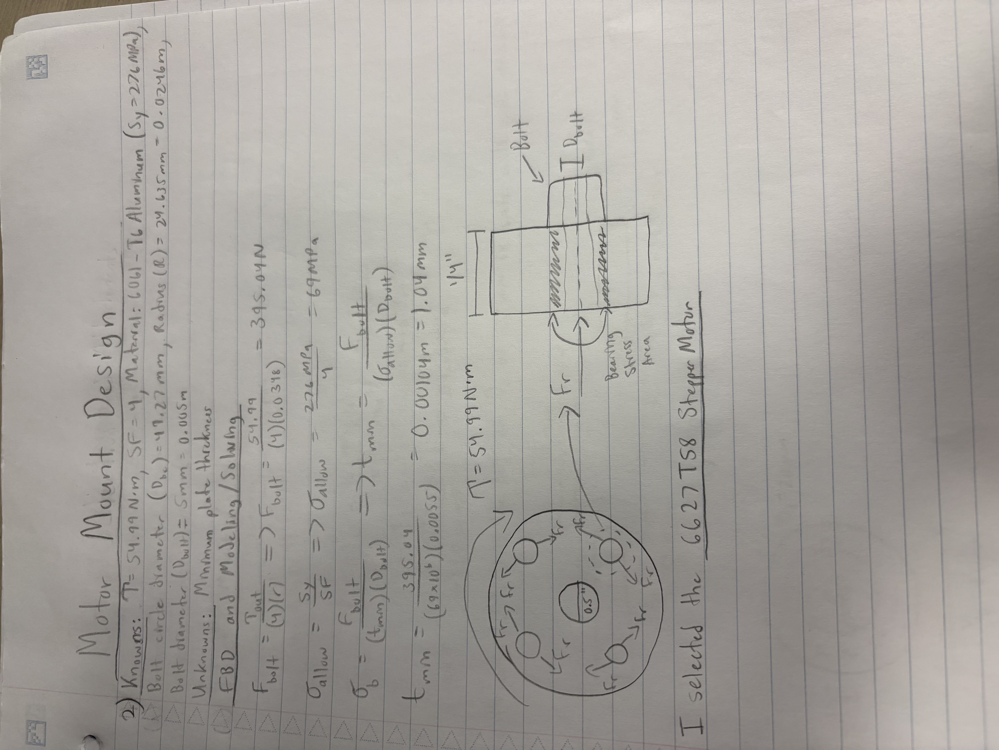
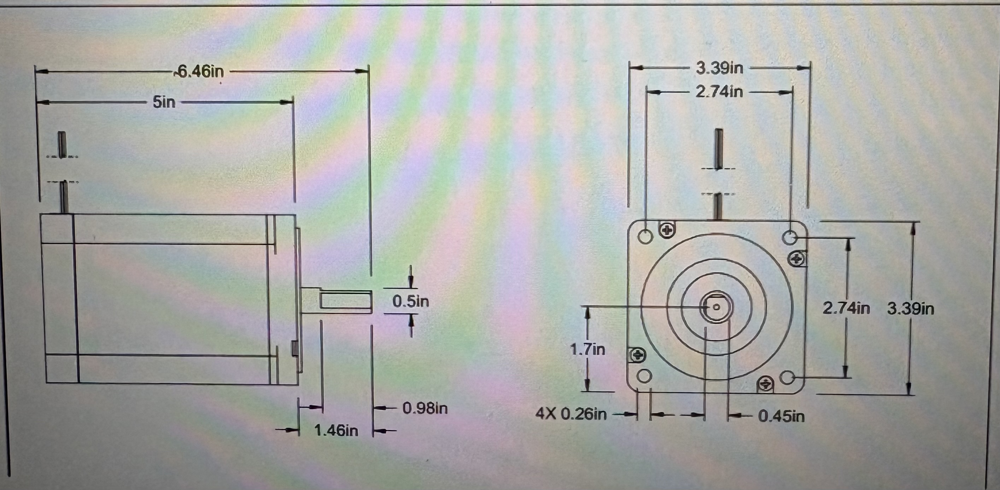

# A11 – Motor Selection

## Objective
The objective of this assignment was to design a bench-top tensile tester that could handle a 2 kN load using two stepper motors and an aluminum extrusion frame. We had to select the proper motors and design a frame that could operate at speeds between 1 and 50 mm/min while accounting for friction in the Acme lead screws and torque acting on the motor mounts. We also had to use a safety factor of 4 and perform calculations and FEA simulations to make sure our overall design was strong enough to handle the applied loads.

## Motor Selection and Attachment - Drew Wayne
Based on the calculations that we had from the leadscrew design, the motor must overcome the friction due to the 1-start 1/2" - 10 ACME screw that we made. 

Knowns: Target Linear Speed: 1-50mm/min, Target Rotational Speed (N): 0.5RPM - 25RPM, Axial Load per Screw: 1000N, Max Required Torque (T): 54.99N*m

Since the required torque of 54.99 N·m is pretty high for a bench-top tensile tester, we determined that a direct-drive stepper motor would not provide enough torque. Because of this, we selected a high-torque NEMA 34 stepper motor with a precision planetary gearbox to increase the torque while still keeping the rotational speed within our required range.

Voltage/Current: 

Current(Amps): For the 6627T671 stepper motor, the rated current is 9.8 A per phase. Since our design requires a total torque of 54.99 N·m to handle the 2 kN load, we need to make sure our stepper driver can supply the required 9.8 A per phase so the motor can produce enough torque.

Voltage(Volts): For our NEMA 34 stepper motor, we decided to use a voltage range of 48–60 V since the motor does not have one fixed operating voltage. At our lowest speed of 1 mm/min, the motor only rotates at about 5 RPM, which allows it to operate near its maximum available torque. At our highest speed of 50 mm/min, the motor experiences more back EMF, which makes it harder for the current to build up. Using a higher supply voltage helps maintain the current and torque as the motor speed increases.

Speed Range: For our design, we used a 1/2"-10 Acme lead screw with a 0.100" pitch and a 10:1 planetary gearbox. Based on our calculations, at the maximum speed of 50 mm/min, the lead screw rotates at about 20 RPM while the motor rotates at 200 RPM. At our minimum speed of 1 mm/min, the lead screw rotates at about 0.4 RPM and the motor rotates at 4 RPM. Our selected motor is rated for speeds up to 2,700 RPM, while our design only requires a maximum of 200 RPM. This means our motor will be operating well below its maximum rated speed throughout the required 1–50 mm/min range. With a 24 V or 48 V power supply, we expect the motor and gearbox combination to provide enough torque to meet our design requirements while maintaining the necessary speed range.

Selected Hardware:
- Motor: NEMA 34 Stepper Motor
- Gearbox: 10:1 Planetary Gearbox for NEMA 34
- Output Torque: 8.5N*m x 10 x 0.85 = 72.25N*m
- Operating Speed: The NEMA stepper motor will have to run at 250RPM to output 25RPM at the gearbox.

## Motor Mount Design
For my motor mount design, I used 6061-T6 aluminum with a safety factor of 4. I calculated the force acting on each mounting bolt and used the allowable bearing stress to determine a minimum plate thickness of 1.04 mm. I also created free-body diagrams to show how the torque affects the mounting bolts and where the bearing stress occurs. After completing the calculations, I selected the 6627T58 stepper motor and used its dimensions and mounting-hole locations as a reference for designing my motor mount in SolidWorks. Also, I ended up going with a custom 6061-T6 aluminum motor mount to help comply with the motor selected.

## Coupler Design
For my coupler design, I selected 4130 steel with a safety factor of 4. I used the torsional shear stress equations to determine if the coupler could safely handle the applied torque of 54.99 N·m. After calculating an allowable shear stress of 66.25 MPa, I checked an outer diameter of 22 mm with an inner diameter of 12.7 mm and calculated a maximum shear stress of 29.61 MPa. Since the maximum shear stress was below the allowable stress, I determined that the selected coupler dimensions would be suitable for my design. I also sketched the coupler and labeled its dimensions to show how it connects the gearbox output shaft to the lead screw. For the coupler, I chose the part 61005k122 from MCMaster.

## Floating Bearing Mount Design
For my floating bearing mount, I designed it to support the bottom end of the ½-inch lead screw while still allowing it to rotate smoothly without binding. I needed to make sure the lead screw stayed aligned with the rest of the system, so I selected an RC3 sliding fit using the American National Standard Running and Sliding Fits table on page 654 of the Machinery’s Handbook.

Since my lead screw has a diameter of 0.5 inches, I used the size range of 0.40 to 0.71 inches from the table. Based on the RC3 fit, the clearance range is 0.0006 to 0.0017 inches. The hole tolerances are +0.0007/0 inches, while the shaft tolerances are -0.0006/-0.0010 inches. Using these values, I determined that the hole diameter should range from 0.5000 to 0.5007 inches and the shaft diameter should range from 0.4990 to 0.4994 inches.

I decided to use 6061-T6 aluminum for the floating bearing mount because it is strong enough for the application, easy to machine, and matches the other aluminum components in my design. I chose the RC3 fit because it provides enough clearance for the lead screw to rotate freely while still keeping it properly aligned. If the fit was too tight, it could cause unnecessary friction and binding, while too much clearance could allow the lead screw to move around more than needed.

For the actual mount, I calculated a plate with four clearance holes so it could be bolted securely to the bottom frame. This also makes it easier to install or remove if needed. I sized the center hole using the RC3 fit tolerances to help support the lead screw while allowing it to rotate smoothly during operation.

## Decide
_Reference your concept selection (Pugh matrix) here. How does this design follow from that decision?_

## Communicate
