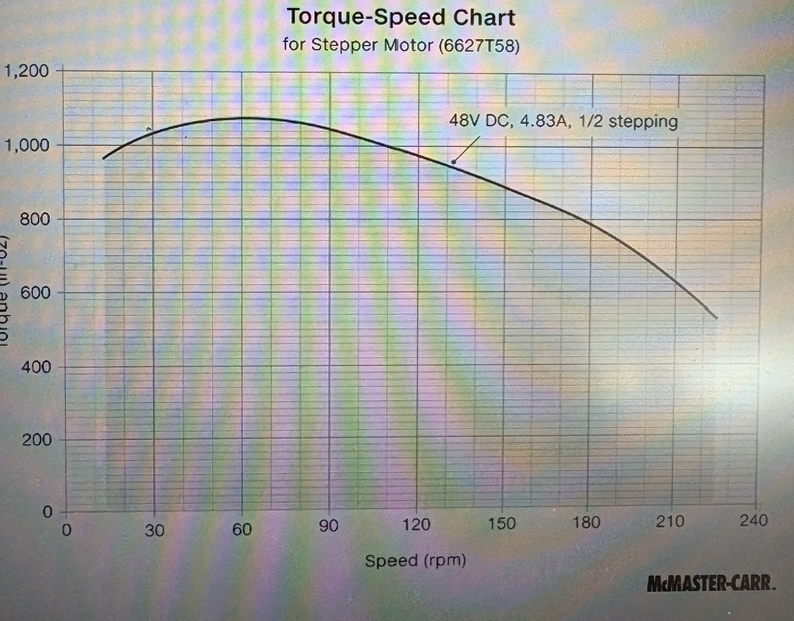
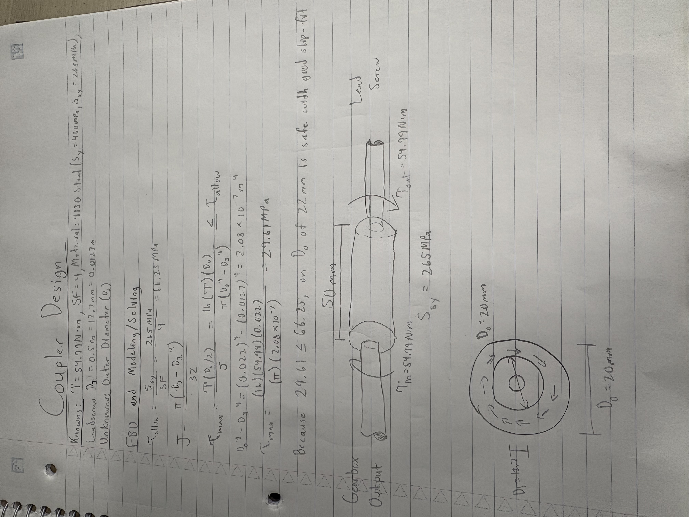
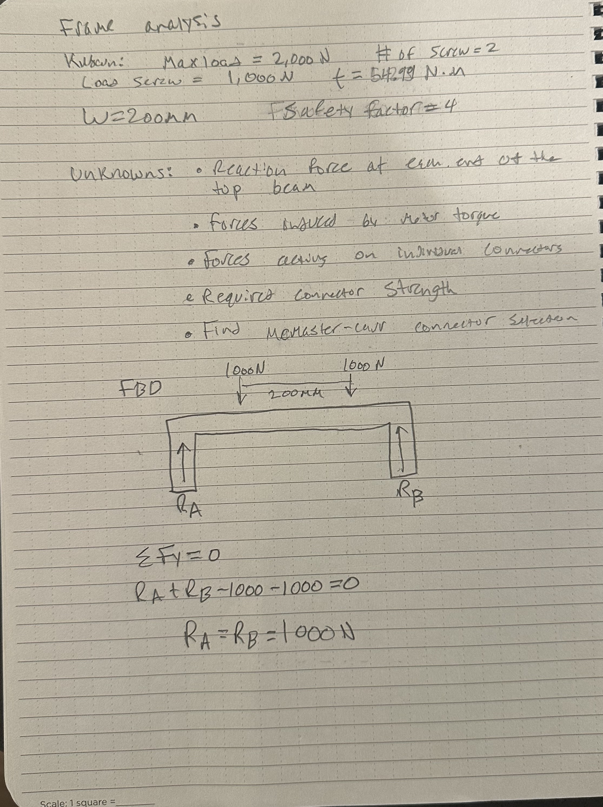
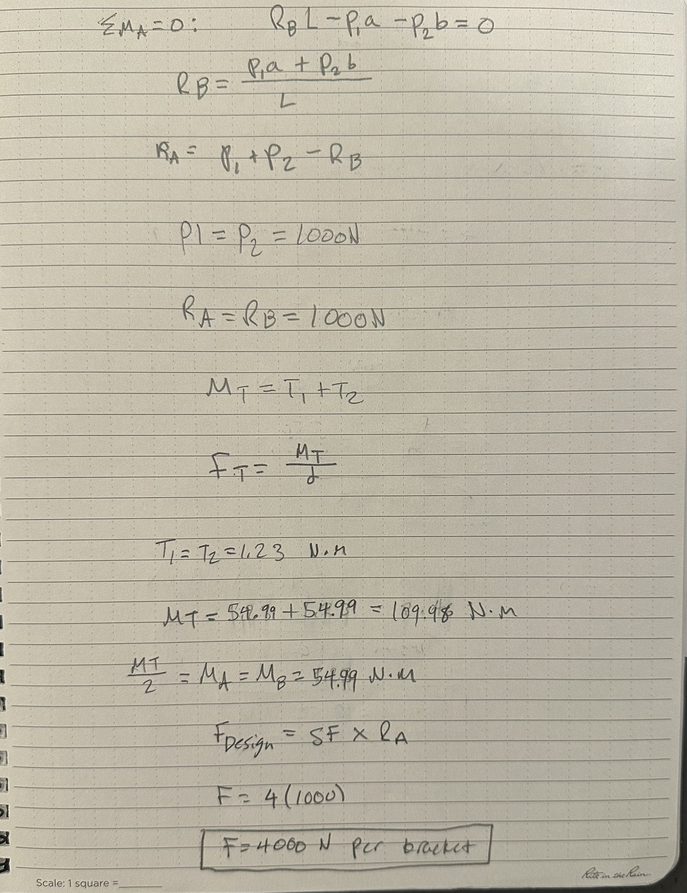
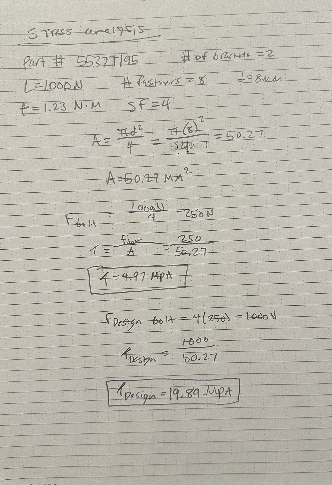

# A11 – Motor Selection

## Objective
The objective of this assignment was to design a bench-top tensile tester that could handle a 2 kN load using two stepper motors and an aluminum extrusion frame. We had to select the proper motors and design a frame that could operate at speeds between 1 and 50 mm/min while accounting for friction in the Acme lead screws and torque acting on the motor mounts. We also had to use a safety factor of 4 and perform calculations and FEA simulations to make sure our overall design was strong enough to handle the applied loads.

## Motor Selection and Attachment - Drew Wayne
Based on the calculations that we had from the leadscrew design, the motor must overcome the friction due to the 1-start 1/2" - 10 ACME screw that we made. 

Knowns: Target Linear Speed: 1-50mm/min, Target Rotational Speed (N): 0.5RPM - 25RPM, Axial Load per Screw: 1000N, Max Required Torque (T): 54.99N*m

Since the required torque of 54.99 N·m is pretty high for a bench-top tensile tester, we determined that a direct-drive stepper motor would not provide enough torque. Because of this, we selected a high-torque NEMA 34 stepper motor with a precision planetary gearbox to increase the torque while still keeping the rotational speed within our required range.

Voltage/Current: 

Current(Amps): For the 6627T671 stepper motor, the rated current is 9.8 A per phase. Since our design requires a total torque of 54.99 N·m to handle the 2 kN load, we need to make sure our stepper driver can supply the required 9.8 A per phase so the motor can produce enough torque.

Voltage(Volts): For our NEMA 34 stepper motor, we decided to use a voltage range of 48–60 V since the motor does not have one fixed operating voltage. At our lowest speed of 1 mm/min, the motor only rotates at about 5 RPM, which allows it to operate near its maximum available torque. At our highest speed of 50 mm/min, the motor experiences more back EMF, which makes it harder for the current to build up. Using a higher supply voltage helps maintain the current and torque as the motor speed increases.

Speed Range: For our design, we used a 1/2"-10 Acme lead screw with a 0.100" pitch and a 10:1 planetary gearbox. Based on our calculations, at the maximum speed of 50 mm/min, the lead screw rotates at about 20 RPM while the motor rotates at 200 RPM. At our minimum speed of 1 mm/min, the lead screw rotates at about 0.4 RPM and the motor rotates at 4 RPM. Our selected motor is rated for speeds up to 2,700 RPM, while our design only requires a maximum of 200 RPM. This means our motor will be operating well below its maximum rated speed throughout the required 1–50 mm/min range. With a 24 V or 48 V power supply, we expect the motor and gearbox combination to provide enough torque to meet our design requirements while maintaining the necessary speed range.

Selected Hardware:
- Motor: NEMA 34 Stepper Motor   (6627T58)
- Gearbox: 10:1 Planetary Gearbox for NEMA 34   (64815K53)
- Output Torque: 8.5N*m x 10 x 0.85 = 72.25N*m
- Operating Speed: The NEMA stepper motor will have to run at 250RPM to output 25RPM at the gearbox.

## Motor Mount Design - Drew Wayne
For my motor mount design, I used 6061-T6 aluminum with a safety factor of 4. I calculated the force acting on each mounting bolt and used the allowable bearing stress to determine a minimum plate thickness of 1.04 mm. I also created free-body diagrams to show how the torque affects the mounting bolts and where the bearing stress occurs. After completing the calculations, I selected the 6627T58 stepper motor and used its dimensions and mounting-hole locations as a reference for designing my motor mount in SolidWorks. Also, I ended up going with a custom 6061-T6 aluminum motor mount to help comply with the motor selected.

## Coupler Design - Drew Wayne
For my coupler design, I selected 4130 steel with a safety factor of 4. I used the torsional shear stress equations to determine if the coupler could safely handle the applied torque of 54.99 N·m. After calculating an allowable shear stress of 66.25 MPa, I checked an outer diameter of 22 mm with an inner diameter of 12.7 mm and calculated a maximum shear stress of 29.61 MPa. Since the maximum shear stress was below the allowable stress, I determined that the selected coupler dimensions would be suitable for my design. I also sketched the coupler and labeled its dimensions to show how it connects the gearbox output shaft to the lead screw. For the coupler, I chose the part 61005k122 from MCMaster.

## Frame Connector Analysis - Mike Sweeney

The objective of 

###Frame Design and Connector Requirements
The top horizontal T-slot rail is connected to two vertical supports using reinforced corner brackets. These connections must withstand the 2 kN tensile load and the twisting moments generated by the motors while maintaining a minimum safety factor of 4.

### Known and Unknown Values
The known values included a total axial load of 2,000 N, two lead screws carrying 1,000 N each, an estimated motor torque of 54.99 N·m per screw, and two vertical supports. The unknowns were the reaction forces at each connection, the motor-induced twisting loads, and the stresses acting on the connectors.

### Free-Body Diagram and Reaction Force Calculations
I developed a free-body diagram of the top horizontal frame to identify the applied forces and support reactions. Using static equilibrium equations, I calculated the forces required at each end of the frame to maintain equilibrium.

### Motor Torque and Connector Stress Analysis
I analyzed the twisting moment generated by the two motors using an assumed design torque of 54.99 N·m per motor, consistent with the motor selection analysis used by our team. The combined motor reaction moment was calculated as 109.98 N·m, assuming both torques act in the same direction. I then evaluated the forces transferred through the upper frame connections and performed a preliminary fastener shear stress analysis using the selected M8 mounting hardware. The required safety factor of 4 was considered throughout the design calculations.

### T-Slot Connector Selection
I selected two McMaster-Carr 5537T195 extended closed gusset brackets to connect the top horizontal rail to the vertical supports. The brackets are manufactured from 6063-T5 aluminum and include eight M8 mounting fasteners each. Their reinforced construction provides additional support against movement at the frame connections.

Selected Component: [McMaster-Carr 5537T195 – Extended Closed Gusset Bracket](https://www.mcmaster.com/5537T195/)

I installed one bracket at each upper corner of the existing frame in SolidWorks. The calculations provided a preliminary assessment of the connection loading, but complete verification of the safety factor would require additional checks of the fasteners and T-slot attachments.

## Floating Bearing Mount Design - Drew Wayne
For my floating bearing mount, I designed it to support the bottom end of the ½-inch lead screw while still allowing it to rotate smoothly without binding. I needed to make sure the lead screw stayed aligned with the rest of the system, so I selected an RC3 sliding fit using the American National Standard Running and Sliding Fits table on page 654 of the Machinery’s Handbook.

Since my lead screw has a diameter of 0.5 inches, I used the size range of 0.40 to 0.71 inches from the table. Based on the RC3 fit, the clearance range is 0.0006 to 0.0017 inches. The hole tolerances are +0.0007/0 inches, while the shaft tolerances are -0.0006/-0.0010 inches. Using these values, I determined that the hole diameter should range from 0.5000 to 0.5007 inches and the shaft diameter should range from 0.4990 to 0.4994 inches.

I decided to use 6061-T6 aluminum for the floating bearing mount because it is strong enough for the application, easy to machine, and matches the other aluminum components in my design. I chose the RC3 fit because it provides enough clearance for the lead screw to rotate freely while still keeping it properly aligned. If the fit was too tight, it could cause unnecessary friction and binding, while too much clearance could allow the lead screw to move around more than needed.

For the actual mount, I calculated a plate with four clearance holes so it could be bolted securely to the bottom frame. This also makes it easier to install or remove if needed. I sized the center hole using the RC3 fit tolerances to help support the lead screw while allowing it to rotate smoothly during operation.

## Decide
_Reference your concept selection (Pugh matrix) here. How does this design follow from that decision?_

## Top Frame FEA- Joel Rivas
Below are the first trial of the stress, deflection, and strain of the top frame. The frame was constrained to frame brackets and motor brackets. The forces applied were the two 1kN force caused by the lead screw, and the torque of 55.9 Nm caused by each motor. 

This is the von mises curve

This is the deflection result

This is the strain result

Below are the results from the second trial of the stress, deflection, and strain of the top frame.

This is the von mises curve

This is the deflection result

This is the strain result

Looking at both runs the maximum stress in the first was 1.509*10^7 Pa compared to 1.523*10^7 Pa in the second. Both occurred at the same location which was at one of the corners of the bottom side flange. This location proves that the peak stress is at the end of the beam. The deflection in the first run was 6.674*10^-3 mm compared to 6.679*10^-3 mm. These values are both really small and show that the beam barely moves in response to the loads, but it does move the most at the center in both cases. The strain in the first run was 5.354*10^-4 and the second run resulted in a total strain of 5.24*10^-5. The strain was greatest in both at the top middle of the frame. The factor of safety was about 21.5, which shows that we definitely had too much material. If we were to adjust it more we would decrease the total amount of material in order to get it closer to a safety factor of 4.

## Vertical Frame FEA- Joel Rivas
For the vertical frame we only tested one singular leg meaning that only half of the forces were necessary. I used 1 kN of axial force going downward, and a transverse load caused by the motors torque which worked out to be 549.9 N because 54.99Nm divided by .10m. 

This is the von mises result

This is the deflection result

This is the strain result

For the second trial I increased the cross sectional area  

This is the von mises result

This is the deflection result

This is the strain result

The max stress in the first trial was 1.8*10^8 Pa compared to the second trial's 4.5*10^7 Pa. The max deflection in the first trial was 7.5mm and 1.875mm in the second. The strain in the first trial was 1.2*10^-3 and the strain in the second trial was 3*10^-4. All the areas of concern were the same in both trials showing that stress was concentrated at the base of the frame, and the deflection was greatest at the point of the loads in the direction of the torque. Increasing the cross sectional area greatly improved all the results allowing us to reach a safety factor of 4. 

## Final Combined Bill of Materials - Mike Sweeney
## Bill of Materials and Labor Costs - Mike Sweeney

The following Bill of Materials combines the components selected for Parts 1 and 2 of the tensile tester design. Material costs were obtained from McMaster-Carr. A $75 allowance was included for the custom 6061-T6 aluminum components. Engineering labor was calculated at the required rate of $35 per hour.

### Combined Bill of Materials

| Component | Qty. | Unit Cost | Total Cost | Part Number |
|---|---:|---:|---:|---|
| Bronze Acme Flange Nut | 2 | $125.72 | $251.44 | [95120A111](https://www.mcmaster.com/95120A111/) |
| Needle-Roller Thrust Bearing | 2 | $4.46 | $8.92 | [5909K31](https://www.mcmaster.com/5909K31/) |
| Thrust Bearing Washer | 4 | $1.40 | $5.60 | [5909K44](https://www.mcmaster.com/5909K44/) |
| Linear Bearing Housing | 2 | $32.66 | $65.32 | [9804K1](https://www.mcmaster.com/9804K1/) |
| 36-inch Acme Lead Screw | 2 | $9.90 | $19.80 | [98935A823](https://www.mcmaster.com/98935A823/) |
| 54-inch T-Slot Frame Rail | 2 | $115.56 | $231.12 | [5537T914](https://www.mcmaster.com/5537T914/) |
| 16-inch T-Slot Frame Rail | 2 | $40.32 | $80.64 | [5537T914](https://www.mcmaster.com/5537T914/) |
| NEMA 34 Stepper Motor | 2 | $465.37 | $930.74 | [6627T58](https://www.mcmaster.com/6627T58/) |
| 10:1 Planetary Gearbox | 2 | $1426.19 | $2852.38 | [64815K53](https://www.mcmaster.com/64815K53/) |
| Steel Shaft Coupler | 2 | $57.43 | $114.86 | [61005K122](https://www.mcmaster.com/61005K122/) |
| Extended Gusset Bracket | 2 | $22.04 | $44.08 | [5537T195](https://www.mcmaster.com/5537T195/) |
| Custom 6061-T6 Aluminum Stock | 1 lot | $75.00 | $75.00 | Estimated Allowance |
| **Total Material Cost** | | | $4679.90 | |

*The $75 custom aluminum cost is an estimated allowance. The vertical frame rails are priced as 54-inch stock, which was shortened to 42 inches for the revised design.*

### Engineering Labor Costs

Engineering labor was calculated at $35 per hour using the time recorded by each team member.

| Team Member | Hours | Hourly Rate | Labor Cost |
|---|---:|---:|---:|
| Mike Sweeney | 9 | $35.00 | $315.00 |
| Joel Rivas | 6.5 | $35.00 | $227.50 |
| Drew Wayne | 5 | $35.00 | $175.00 |
| **Total** | **20.5** | | **$717.50** |

### Total Project Cost

| Cost Category | Total |
|---|---:|
| Material Costs | $4,679.90 |
| Engineering Labor Costs | $717.50 |
| Total Estimated Project Cost | **$5,397.40** | |

## Lessons Learned - Mike Sweeney
Throughout this assignment, our team learned how the motor, lead screws, couplers, bearings, and frame connections must work together to create a functional tensile tester. During motor selection, we learned the importance of using the required torque and rotational speed to evaluate motor and gearbox performance rather than selecting components based only on their max ratings. We also applied bearing stress and torsional shear stress equations to determine suitable dimesnions for motor mounts and shaft couplers. 

During the frame design, we learned how axial loading and motor-induced twisting moments affects the connections between the horizontal and vertical supports. Using free-body diagrams and static equilibrium equations, we calculated the reaction forces and evaluated the stresses acting on the mounting hardware. We also learned how important compnent compatbility is when selecting commericaly availble parts, particuarly mounting hole pattersn shaft diameter and T slot Connector Dimensions.

One challenge our team encountered was integrating the selected components into the existing SolidWorks assembly. We modified the frame dimensions to create a more manageable design and adjusted assembly mates to align the components. If we were to improve the design further, we would verify the complete connection strengths and evaluate additional mounting arrangements to improve structural rigidity. 

## Time Spent 
Our team spent a combined 25.5 hours on these assignments:
- Mike Sweeney: 9 hours
- Joel Rivas: 12.5 hours
- Drew Wayne: 5 hours

## 2157 Section- Joel Rivas

Floating Bearing Mount Drawing

Motor Mount Drawing

Full Assembly

Cross Head Drawing

## CAD Downloads:
Floating Bearing Mount Body and Drawing- [docs/assignments/a11/Floating Bearing Mount Drawing.zip
](https://github.com/jrivasvi/megr2157-portfolio/blob/7b3990b0b9bd98d450a4f21446d4f0ec61d1ffdd/docs/assignments/a11/Floating%20Bearing%20Mount%20Drawing.zip)

Motor Mount Body and Drawing- https://github.com/jrivasvi/megr2157-portfolio/blob/c7275b446ebd07cb2e053e348c9e5725b097ab10/docs/assignments/a11/MotorMount%20Drawing.zip

Crosshead- https://github.com/jrivasvi/megr2157-portfolio/blob/f3823504fb5fd96aa32c6df925f3d2ff646305ff/docs/assignments/A10/A10_Crosshead.SLDPRT

Full Assembly- https://github.com/jrivasvi/megr2157-portfolio/blob/6ca8a3e4c3e1ed9a4f60a610d9fa1de76db62d0b/docs/assignments/a11/A10Part2Assem1%20(1).SLDASM
https://github.com/jrivasvi/megr2157-portfolio/blob/280c40da4700c96512a6fc2b04a92e027888af25/docs/assignments/a11/A10Part2Assem1%20(1)%20Drawing.SLDDRW

